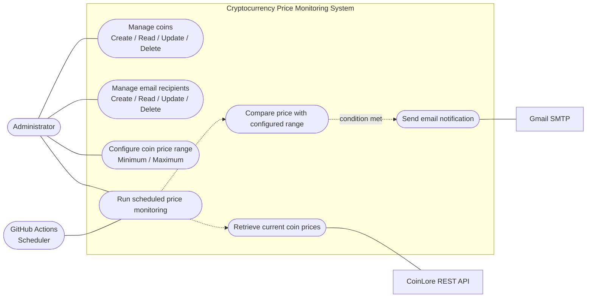

# Figure 1. Use-Case Diagram — Cryptocurrency Price Monitoring System

**Description:** The administrator manages coins, configured price ranges, and email recipients. GitHub Actions starts scheduled monitoring. The system retrieves prices from CoinLore, compares them with configured ranges, and uses Gmail SMTP to send notifications when the condition is met.

**Verification note:** Confirm the exact workflow schedule, price-range comparison rule, and notification behavior against the current `README.md` and source code.
