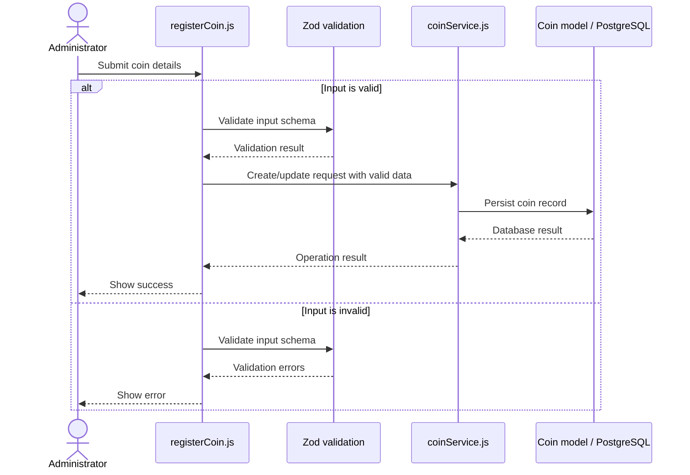

# Figure 2. Sequence Diagram — Add Coin

**Description:** The administrator submits coin information. `registerCoin.js` sends the input through Zod validation, then calls `coinService.js` to persist the coin using the Coin model and PostgreSQL database. Validation and database failures must not be reported as successful saves.

**Note:** Success is returned only after the database operation succeeds. Invalid input or a database failure should produce an error result.
