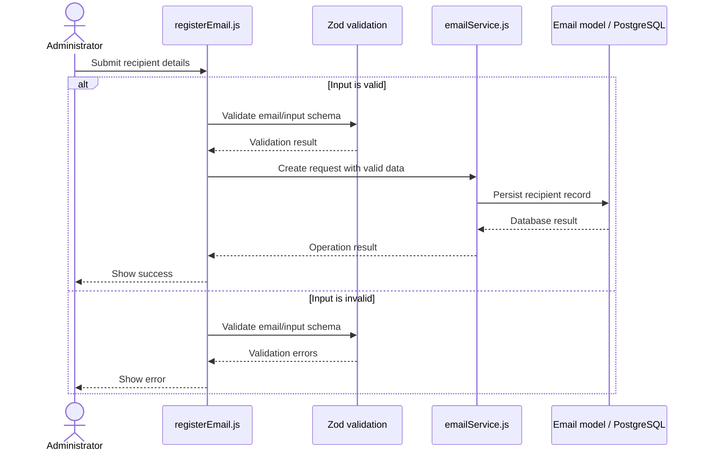

# Figure 3. Sequence Diagram — Add Email Recipient

**Description:** The administrator submits recipient information. `registerEmail.js` validates the input with Zod and calls `emailService.js` to save the recipient through the Email model and PostgreSQL database.

**Note:** Validate recipient data before saving. Match the exact schema and stored fields to the source code.
