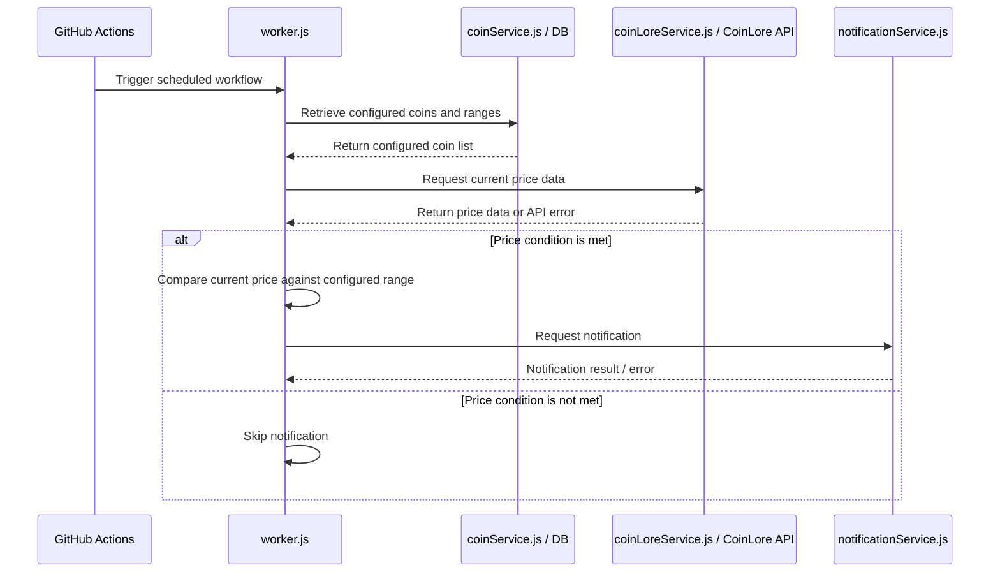

# Figure 4. Sequence Diagram — Monitor Cryptocurrency Price

**Description:** GitHub Actions triggers `worker.js`. The worker loads configured coins and ranges, requests price data through `coinLoreService.js`, compares the price with the configured condition, and requests notification only when that condition is met.

**Verification note:** Confirm the exact schedule, price-range rule, and repeat-notification behavior in `monitor.yml` and the source code.
