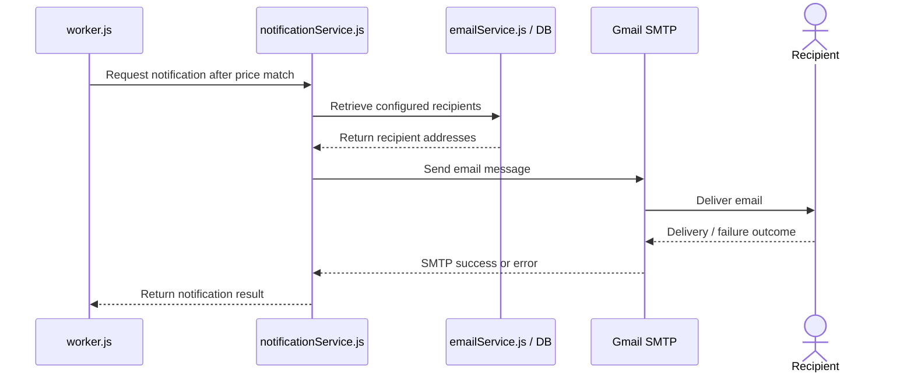

# Figure 5. Sequence Diagram — Send Email Notification

**Description:** After a price condition is met, `worker.js` calls `notificationService.js`. The notification service retrieves configured recipients through `emailService.js` and sends the message through Gmail SMTP.

**Note:** This represents the intended notification path. Confirm exact recipient lookup and error-handling behavior against `notificationService.js` and `emailService.js`.
